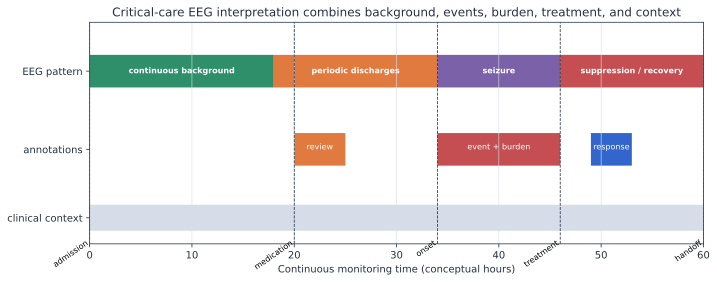

# 重症监护与新生儿 EEG

重症 EEG 的重点是连续背景、随时间演变的模式、发作负荷、治疗反应和临床语境。它与离线短片段分类完全不同；本页只用于科研入门，不能指导患者治疗。

## 连续 EEG 要描述什么

| 维度 | 例子 | 为什么重要 |
|---|---|---|
| 背景 | 连续/不连续、主要频率、对称性、电压 | 决定其他模式的解释背景 |
| 反应性 | 对声音、疼痛或操作的变化 | 与脑状态和预后研究相关 |
| 周期/节律模式 | LPD、GPD、LRDA、GRDA | 需按位置、频率、演变和修饰词描述 |
| 发作 | 起始、演变、持续、空间分布 | 评价事件数、负荷、延迟和治疗反应 |
| 抑制 | burst attenuation/suppression、抑制比例 | 可能与药物、体温和脑损伤共同相关 |
| 临床事件 | 用药、操作、体温、循环、影像 | EEG 变化不能脱离时间线解释 |

ACNS 2021 术语提供共同语言，但术语描述不自动给出病因，也不自动规定是否治疗。

## 新生儿为什么必须单独学习

新生儿 EEG 随胎龄和出生后年龄快速变化。背景不连续、睡眠—觉醒组织和发作形态与成人不同；成人阈值和导联经验不能直接迁移。

### Helsinki 数据集提供的教学机会

- 79 名足月新生儿，19 电极、256 Hz。
- 三名专家独立逐秒标注，允许研究共识和标签不确定性。
- 含发作与无发作病例，也包含伪迹和记录暂停。
- 数据与代码分别在 [Zenodo](https://zenodo.org/records/1280684) 和 [GitHub](https://github.com/ktapani/Neonatal_Seizure_Detection)。

## 研究任务层级

1. **模式检索**：帮助专家快速跳转可疑时间段。
2. **发作检测**：连续记录中识别起止事件。
3. **负荷估计**：每小时发作时间和随治疗变化。
4. **预后研究**：EEG 是否在临床变量之外增加信息。

模型开发应优先支持人机协作和可审核时间线，而不是把黑盒标签当作独立临床结论。

## 评价与划分

- 按患者划分；同一患者不同时间段不能跨训练/测试。
- 事件指标包括患者级/事件级灵敏度、误报/小时、延迟、重叠和负荷误差。
- 报告专家之间一致性，并说明使用单专家、并集、交集还是多数共识。
- 外部测试要说明年龄、病因、设备、蒙太奇和用药差异。

## 推荐阅读

- ACNS 2021 术语：[`10.1097/WNP.0000000000000806`](https://doi.org/10.1097/WNP.0000000000000806)
- 新生儿数据：[`10.1038/sdata.2019.39`](https://doi.org/10.1038/sdata.2019.39)
- SzCORE 评估框架：[`10.1111/epi.18113`](https://doi.org/10.1111/epi.18113)

!!! danger "临床安全边界"
    任何自动报警或定量趋势都必须回看原始 EEG，并由具备资质的临床人员结合病史、体征、药物和其他检查解释。

