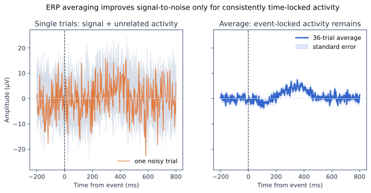
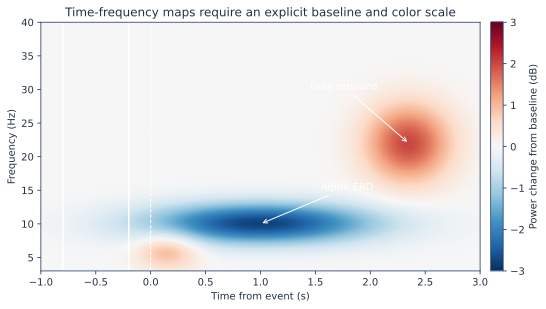

# ERP、频谱与时频分析

三类图回答不同问题：ERP 看事件锁定电位，频谱看一段时间内的频率构成，时频图看功率或相位怎样随事件演变。它们不能互相替代。

## ERP：从试次到条件平均

ERP 平均依赖一个关键前提：目标活动在各试次相对于事件具有相近的时间和相位。与事件无关的活动会在平均中部分抵消；潜伏期抖动很大的成分也会被压低和展宽。

### ERP 分析清单

- 检查事件码、刺激呈现延迟和行为反应是否对齐。
- 在看条件差异前定义通道、时间窗和主对比。
- 报告每个条件每名参与者的有效试次数。
- 基线校正不是自动去漂移；基线本身有条件差异时要重新考虑。
- 峰值易受噪声和搜索窗口影响，平均振幅通常更稳健。
- 群体图应有置信区间或个体点，不只画一条漂亮均值线。

## 频谱：先分清峰和背景

Welch PSD 把长记录分段、加窗并平均，是稳健的第一步。但固定 Delta/Theta/Alpha/Beta 功率会同时受到窄带峰和 1/f 样非周期背景影响。比较年龄、麻醉或疾病人群时尤其要考虑周期/非周期分离。

## 时频：颜色代表相对什么

常见量包括绝对功率、相对基线百分比、dB 变化、试次间相位一致性和诱发功率。颜色相似并不代表物理量相同。

| 问题 | 推荐量 | 关键参数 | 常见错误 |
|---|---|---|---|
| 某节律是否增强/减弱 | 基线归一化功率 | 小波周期数、基线、平滑 | 基线被任务预期污染 |
| 活动是否相位锁定 | ITPC/PLV | 试次数、相位估计 | 条件试次数不平衡 |
| ERP 是否解释了时频效应 | 诱发与非诱发功率 | 是否先减 ERP | 把相位锁定活动当作诱导振荡 |
| 效应何时出现 | 时间—频率统计 | 搜索范围、多重比较 | 在整张图挑最亮像素报告 |

## 分辨率权衡

- 短窗定位时间更准，但低频估计不稳定。
- 长窗频率分辨率更高，但会把快速变化抹平。
- 小波周期数可以随频率改变，但必须报告。
- 低频需要更长 Epoch；边缘区域受卷积影响，应裁去或标记。

## 最小可复现实验

1. 在一个运动想象数据集上计算 C3/C4 的 8–13 Hz 与 13–30 Hz 时频功率。
2. 分别用 `[-1, -0.2] s` 和 `[-0.5, 0] s` 基线，比较结果是否稳定。
3. 报告每名受试者的 ERD，而不只展示群体平均。
4. 交换条件标签做置换检查；若仍出现系统性图案，查找泄漏或处理偏差。

## 推荐阅读

- Welch PSD：[`10.1109/TAU.1967.1161901`](https://doi.org/10.1109/TAU.1967.1161901)
- 周期/非周期参数化：[`10.1038/s41593-020-00744-x`](https://doi.org/10.1038/s41593-020-00744-x)
- FieldTrip：[`10.1155/2011/156869`](https://doi.org/10.1155/2011/156869)

