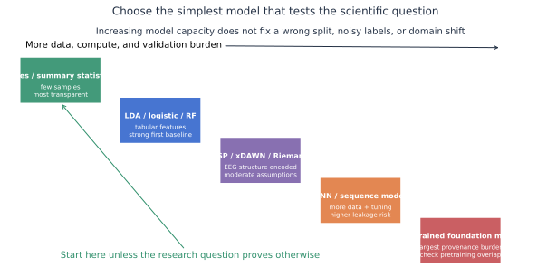

# 特征、模型与可信评估

模型选择应从研究问题、样本单位和可验证性出发。EEG 的窗口数量看起来很大，但独立信息常由受试者、记录或会话数量决定；把一名受试者切成一万个窗口，不等于有一万个独立样本。

## 常见表示

| 表示 | 保留的信息 | 适合的第一基线 | 主要风险 |
|---|---|---|---|
| 原始波形 | 时间形态与相位 | 1D CNN 前先做简单统计 | 设备、幅值和滤波捷径 |
| 频带/谱参数 | 频率和 1/f 背景 | Logistic、LDA、RF | 频带定义与伪迹混杂 |
| ERP 振幅/潜伏期 | 事件锁定成分 | LDA、线性混合模型 | 选择性通道/时间窗搜索 |
| 协方差矩阵 | 多通道共同变化 | CSP+LDA、黎曼几何 | 非平稳和参考影响 |
| 时频图 | 时间—频率联合模式 | 统计 ROI、浅层 CNN | 图像化带来高维过拟合 |
| 图/连接矩阵 | 节点与边 | 正则线性模型 | 体积传导、边数爆炸 |
| 预训练表示 | 跨任务潜在特征 | 线性探针后再微调 | 预训练重叠和来源不透明 |

## 推荐的基线阶梯

1. **多数类/随机规则**：确认指标和代码没有“天然高分”。
2. **单变量或摘要统计**：看信号中是否有预期效应。
3. **正则线性模型**：Logistic/LDA/Ridge，易校准和解释。
4. **EEG 结构化模型**：xDAWN、CSP、CCA、黎曼几何。
5. **紧凑深度网络**：EEGNet、浅层 CNN，参数量与样本匹配。
6. **复杂序列/预训练模型**：只有在严格划分和强基线之后使用。

## 四种不同的泛化问题

| 设置 | 训练与测试关系 | 回答的问题 |
|---|---|---|
| 受试者内 | 同一人不同试次/运行 | 是否能为已校准用户解码 |
| 跨会话 | 同一人不同日期 | 模型能否抵抗状态和电极变化 |
| 跨受试者 | 测试人从未出现在训练中 | 新用户是否可直接使用 |
| 跨数据集/中心 | 设备、协议或人群改变 | 结论能否迁移到真实外部环境 |

这四个结果不能用同一个“Accuracy”替代。必须在标题和表格中明确泛化层级。

## 泄漏审计

- 同一受试者、患者、夜晚、手术或连续记录是否跨集合？
- 归一化、伪迹阈值、特征选择和数据增强是否只在训练折拟合？
- 预训练语料是否含测试数据、同一数据库或其衍生版本？
- 重叠窗口是否被拆到不同集合？
- 病例组与对照组是否来自不同设备、科室或年份？
- 标签文件名、记录长度、通道数量是否直接暴露类别？

## 指标选择

- 类别不平衡：Balanced Accuracy、Macro-F1、每类灵敏度。
- 风险预测：AUROC 之外加入 AUPRC、校准曲线和 Brier 分数。
- 连续事件：事件灵敏度、误报/小时、检测延迟和报警持续时间。
- 睡眠序列：Macro-F1、Cohen's κ、逐阶段结果和整夜 Hypnogram。
- 回归/预后：MAE/RMSE、校准、增量价值和置信区间。

## 基础模型的额外检查

BENDR、EEGPT 等工作说明跨数据预训练的潜力，但使用时应保存：预训练数据清单、通道映射、采样率变换、冻结/微调策略、模型权重版本和数据重叠审计。一个通用表示在某任务上有效，不等于学到了可解释的神经生理机制。

## 推荐阅读与代码

- 黎曼几何：[`10.1109/TBME.2011.2172210`](https://doi.org/10.1109/TBME.2011.2172210) · [pyRiemann](https://github.com/pyRiemann/pyRiemann)
- EEGNet：[`10.1088/1741-2552/aace8c`](https://doi.org/10.1088/1741-2552/aace8c) · [代码](https://github.com/vlawhern/arl-eegmodels)
- Braindecode：[`10.1002/hbm.23730`](https://doi.org/10.1002/hbm.23730) · [代码](https://github.com/braindecode/braindecode)
- MOABB：[`10.1088/1741-2552/aadea0`](https://doi.org/10.1088/1741-2552/aadea0) · [代码](https://github.com/NeuroTechX/moabb)
- BENDR：[`10.3389/fnhum.2021.653659`](https://doi.org/10.3389/fnhum.2021.653659) · [代码](https://github.com/SPOClab-ca/BENDR)
- EEGPT：[`10.52202/079017-1239`](https://doi.org/10.52202/079017-1239) · [代码](https://github.com/BINE022/EEGPT)

