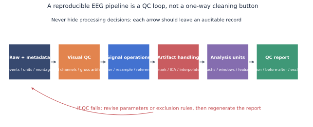
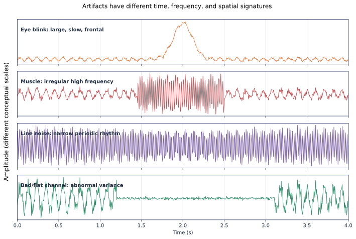

# EEG 预处理与质量控制

预处理不是“让图变干净”，而是把采集缺陷、伪迹与分析假设显式化。任何删除、插值或滤波都可能同时移除神经信号，所以必须保留清理前后对照和质控记录。



## 推荐顺序

| 步骤 | 先问什么 | 常见操作 | 必须记录 |
|---|---|---|---|
| 导入 | 单位、参考、通道类型和事件是否正确 | 读取 EDF/BrainVision/EEGLAB/BIDS | 文件哈希、数据版本、原始参考 |
| 初看 | 是否有饱和、断线、桥接或长段运动 | 浏览原始波形和通道统计 | 坏段、坏导及判定理由 |
| 工频 | 50/60 Hz 是否确实突出 | 陷波或频域去噪 | 目标频率、带宽、谐波 |
| 滤波 | 分析成分需要哪些时间尺度 | 高通、低通、带通 | 类型、截止频率、阶数、零相位与否 |
| 降采样 | 目标最高频率是多少 | 抗混叠低通后重采样 | 原/新采样率和滤波设置 |
| 参考 | 哪个参考与研究问题相容 | 平均、乳突、REST 等 | 原始与最终参考、排除电极 |
| 伪迹 | 伪迹是局部、瞬时还是混合源 | 标记、拒绝、ICA、回归、插值 | 删除成分/片段及证据 |
| 切段 | 事件、基线和边界是否可靠 | Epoch 或连续窗口 | 时间窗、重叠、基线和保留率 |

## 常见伪迹的识别线索



| 类型 | 时间特征 | 频率特征 | 空间特征 | 处理思路 |
|---|---|---|---|---|
| 眨眼/垂直眼动 | 大而缓慢、与眨眼同步 | 低频占优 | 额极最强且双侧相似 | EOG/ICA 辅助，保留判定证据 |
| 水平眼动 | 左右方向相关 | 低频 | F7/F8 或外眼角呈反相 | HEOG 或 ICA，不盲删额区信号 |
| 肌电 | 突发、锯齿或持续紧张 | 宽带高频 | 颞侧、下颌附近常见 | 标记坏段、改善采集，慎用低通掩盖 |
| 心电 | 周期性尖峰 | 心率及谐波 | 邻近血管/颈部更明显 | ECG 辅助 ICA，检查脑成分混入 |
| 工频 | 稳定周期 | 50/60 Hz 窄峰及谐波 | 多导同时出现 | 先查接地和阻抗，再做数字处理 |
| 坏导/桥接 | 平坦、跳变或异常相似 | 全频异常 | 单导或相邻导 | 插值前先标记，报告数量和位置 |

## 滤波的四个陷阱

1. **高通过高会扭曲慢 ERP。** 对 P300、MMN 等分析要检查阶跃响应和边缘伪影。
2. **零相位不等于实时。** 双向滤波使用未来样本，不能直接部署为在线 BCI。
3. **陷波会改变邻近频率。** SSVEP/ASSR 如果靠近工频，应优先改善采集并明确方法。
4. **先切短段再滤波容易产生边界效应。** 通常在连续数据上滤波，并为 Epoch 留足缓冲。

## ICA 不是自动删除器

ICA 假设观测通道是相对稳定的线性混合。成分判定至少同时看：头皮拓扑、时间序列、功率谱、与 EOG/ECG 的关系以及出现时段。ICLabel 等工具输出的是辅助概率，不是“脑/非脑”的绝对真值。

## 最小质控报告

```text
原始时长 / 最终保留时长
原始通道 / 坏导 / 插值通道
原始 Epoch / 拒绝 Epoch / 条件内保留率
ICA 成分总数 / 删除成分及类别证据
每名受试者的峰峰值、方差、工频和频谱异常
清理前后波形、PSD、ERP 或目标特征对照
```

!!! warning "不要追求统一的“干净率”"
    不同年龄、任务和临床人群的伪迹结构不同。阈值必须与数据、设备、范式和科学问题共同决定。

## 推荐阅读

- PREP：[`10.3389/fninf.2015.00016`](https://doi.org/10.3389/fninf.2015.00016)
- Autoreject：[`10.1016/j.neuroimage.2017.06.030`](https://doi.org/10.1016/j.neuroimage.2017.06.030)
- ICLabel：[`10.1016/j.neuroimage.2019.05.026`](https://doi.org/10.1016/j.neuroimage.2019.05.026)
- HAPPE+ER：[`10.1016/j.dcn.2022.101140`](https://doi.org/10.1016/j.dcn.2022.101140)

