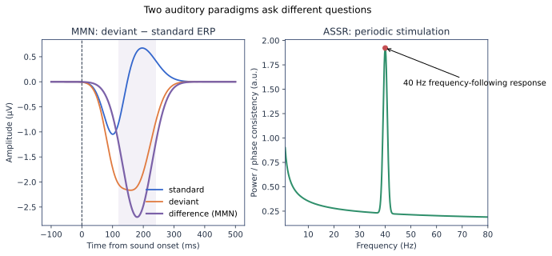

# MMN 与听觉稳态反应 ASSR

MMN 和 ASSR 都使用听觉刺激，但提问方式不同：MMN 看偶发变化相对于重复规律产生的事件相关差异；ASSR 看周期刺激是否产生稳定的频率跟随。

## MMN：被动听觉 Oddball {#mmn}

典型序列包含高概率标准音与低概率偏差音，偏差可以是频率、时长、强度、空间位置或规则变化。通常计算“偏差 ERP − 标准 ERP”，在额中央约 100–250 ms 范围观察负向差异；准确时间和分布取决于刺激与人群。

### 设计要点

- 标准与偏差在物理属性和出现概率上同时不同，必要时加入控制序列分离适应与变化检测。
- 相邻刺激间隔、偏差概率和序列规则会改变效应。
- 被试可以看无声视频，但要控制注意分配和听力状态。
- 报告每种刺激的有效试次、差异波构造和预定义时间窗。

## ASSR：周期频率跟随 {#assr}

ASSR 使用规则重复的点击、纯音或调幅音。若刺激调制为 40 Hz，可在 EEG 频谱或相位一致性中寻找 40 Hz 响应。分析常比较目标频率与邻近噪声频点，或刺激前后/条件间变化。

### 设计要点

- 屏幕刷新率与声卡采样会影响实际刺激频率，需用光电二极管或音频回环验证。
- 记录时间决定频率分辨率；过短 Epoch 难以区分邻近频点。
- 50/60 Hz 工频及谐波可能与 ASSR 冲突。
- 只看功率可能混入背景变化；同时考虑相位锁定和信噪比。

## 两者对比

| 维度 | MMN | ASSR |
|---|---|---|
| 核心问题 | 大脑是否检测序列中的变化 | 神经活动是否跟随周期刺激 |
| 表示 | ERP 与差异波 | 频谱、SNR、相位一致性 |
| 时间单位 | 单个刺激周围 Epoch | 周期刺激区块或短 Epoch |
| 关键对照 | 偏差、标准、控制序列 | 目标频率、邻频、刺激条件 |
| 主要风险 | 适应效应、试次数不平衡 | 工频、刺激时序误差、频谱泄漏 |

## 入门任务

1. 用合成数据分别生成标准/偏差 ERP 和 40 Hz 频率峰。
2. 改变 MMN 偏差概率和 ASSR 区块长度，观察估计稳定性。
3. 做一次标签置换或目标频率偏移检查，确认分析不会在任意频点产生“阳性”。

## 经典论文

- MMN 奠基：[`10.1016/0001-6918(78)90006-9`](https://doi.org/10.1016/0001-6918(78)90006-9)
- MMN 综述：[`10.1016/j.clinph.2007.04.026`](https://doi.org/10.1016/j.clinph.2007.04.026)
- 40 Hz ASSR：[`10.1073/pnas.78.4.2643`](https://doi.org/10.1073/pnas.78.4.2643)
