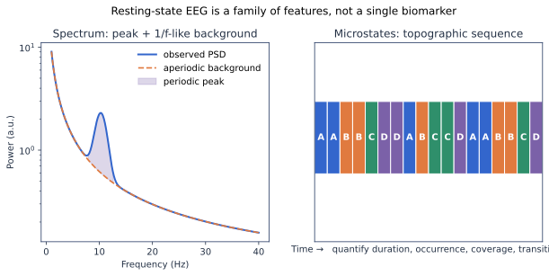

# 静息态 EEG

静息态不是“什么都不做”。姿势、睁闭眼顺序、警觉、困倦、注视点、记录时长、药物和采集环境都会改变结果。它适合研究内在节律和个体差异，也最容易被混杂因素伪装成生物标志物。

## 最小范式

| 项目 | 入门设置 | 为什么要控制 |
|---|---|---|
| 条件 | 睁眼 3–5 分钟 + 闭眼 3–5 分钟 | Alpha 反应提供基本技术验证 |
| 顺序 | 交替区块或记录固定顺序 | 顺序与疲劳可能混杂 |
| 睁眼 | 固定注视点，限制眼动 | 视觉输入与眼动影响后部节律 |
| 闭眼 | 提醒保持清醒 | 困倦会增加低频并改变微状态 |
| 记录 | 同时记药物、咖啡因、睡眠和时间 | 状态变量可能大于组间效应 |

## 特征家族

1. **频谱**：绝对/相对功率、个体 Alpha 峰、谱斜率和周期峰。
2. **空间**：头皮功率分布、脑对称指数；参考选择会影响结果。
3. **连接性**：相干、wPLI、AEC；必须处理体积传导和多重比较。
4. **复杂度**：熵、Lempel–Ziv、分形指标；对噪声、长度和滤波敏感。
5. **微状态**：类别拓扑、持续时间、出现率、覆盖率和转移。

## 推荐数据集

- [LEMON / OpenNeuro ds000221](https://openneuro.org/datasets/ds000221)：年轻与老年、多模态健康队列。
- [TDBRAIN](https://www.synapse.org/TDBRAIN)：1274 人临床生命周期数据，需接受使用协议。
- [Dortmund Vital / ds005385](https://openneuro.org/datasets/ds005385/versions/1.0.2)：608 人，含任务前后与五年随访。
- [AD/FTD / ds004504](https://openneuro.org/datasets/ds004504)：88 人临床教学数据。

## 入门实验

1. 对每人分别计算睁眼与闭眼枕区 PSD。
2. 找个体 Alpha 峰，而不是只积分固定 8–13 Hz。
3. 拟合非周期背景，比较“总 Alpha 功率”和“高于背景的峰”。
4. 画每名参与者的条件差，不只画组均值。
5. 用记录前半/后半或不同区块估计重测稳定性。

## 常见错误

- 把相对功率增加解释为绝对功率增加。
- 未控制年龄、困倦和药物，却解释为疾病效应。
- 用同一数据挑频带、通道和阈值再报告显著性。
- 在小样本中尝试成千上万连接边并只展示最好结果。
- 把组水平减慢或微状态差异宣传为个体诊断工具。

## 关键文献

- Alpha/Theta 综述：[`10.1016/S0165-0173(98)00056-3`](https://doi.org/10.1016/S0165-0173(98)00056-3)
- 微状态综述：[`10.1016/j.neuroimage.2017.11.062`](https://doi.org/10.1016/j.neuroimage.2017.11.062)
- 周期/非周期参数化：[`10.1038/s41593-020-00744-x`](https://doi.org/10.1038/s41593-020-00744-x)
- TDBRAIN：[`10.1038/s41597-022-01409-z`](https://doi.org/10.1038/s41597-022-01409-z)
- Dortmund Vital：[`10.1038/s41597-024-03797-w`](https://doi.org/10.1038/s41597-024-03797-w)

