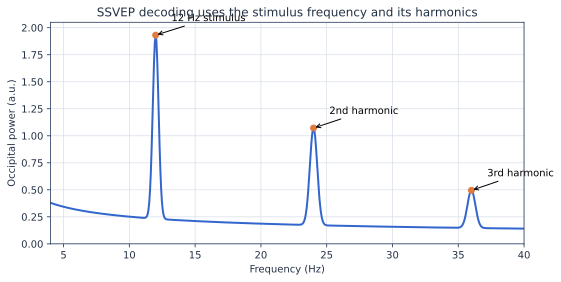

# 稳态视觉诱发电位 SSVEP

注视周期性闪烁刺激时，枕区 EEG 可在刺激频率及其谐波处出现稳定响应。SSVEP 很适合学习频谱分析、空间滤波和多类别 BCI。

*图解：刺激频率是 12 Hz，但响应还可能出现在 24 Hz 和 36 Hz。*

### 为什么会有谐波

视觉系统和刺激波形并非理想线性正弦系统，周期响应可含基频的整数倍。CCA 参考通常加入多个谐波，但越多不一定越好：高次谐波可能接近工频、肌电或其他类别频率。

## 先理解实验装置

显示器刷新率会限制可实现的刺激频率。实验必须记录真实刷新率、每个频率的帧序列、刺激持续时间和相位；不能只写“设置为 12 Hz”就认为刺激精确。

| 设计项 | 入门建议 | 风险 |
|---|---|---|
| 频率 | 选择彼此分开的 4–6 个频率 | 谐波重叠会混淆类别 |
| 时长 | 每 Trial 2–5 秒 | 太短时频率分辨率不足 |
| 位置 | 视野中固定位置 | 眼动可能直接泄露标签 |
| 通道 | O1/O2/Oz/POz 周围 | 只用单通道会降低稳健性 |

## 最小分析流程

1. 检查光标记或事件码与屏幕刺激的时间延迟。
2. 对每类刺激画枕区 PSD，确认基频和谐波峰。
3. 建立“选择目标频率最大功率”的透明基线。
4. 使用含正弦/余弦和谐波参考信号的 CCA 分类。
5. 按实验块或会话交叉验证，报告 Accuracy 与信息传输率时同时给出 Trial 时长和决策间隔。

## 数据与练习

MNE-BIDS 的 SSVEP 示例适合完成首次流程。练习时比较 1 秒、2 秒、4 秒窗口，以及只用基频和加入 2–3 个谐波时的性能。所有参数必须只在训练数据中选择。

## 常见错误

- 频率标签可由眼动、刺激位置或 Trial 顺序预测。
- 用零相位离线滤波的结果宣称可达到同样的实时延迟。
- 忽略显示器刷新和触发延迟。
- 只报告最高 Accuracy，不报告决策时间和无效 Trial。

## 经典论文

| Year | Paper | Interpretation | DOI | Code |
|---:|---|---|---|---|
| 1966 | Regan, *Some characteristics of average steady-state...* | 稳态视觉诱发响应的奠基研究 | [10.1016/0013-4694(66)90088-5](https://doi.org/10.1016/0013-4694(66)90088-5) | 未发现 |
| 2018 | Lawhern et al., *EEGNet* | 跨范式紧凑神经网络基线 | [10.1088/1741-2552/aace8c](https://doi.org/10.1088/1741-2552/aace8c) | [作者代码](https://github.com/vlawhern/arl-eegmodels) |

??? question "完成本节前自测"
    1. 60 Hz 屏幕能否精确呈现任意 13 Hz 方波？通常不能，需要由帧序列近似并实测。
    2. 为什么 1 秒窗口比 4 秒窗口频率分辨率更差？观察时间更短，频率估计信息更少。
    3. 离线零相位滤波结果能否直接当实时延迟？不能，它使用了未来样本。
