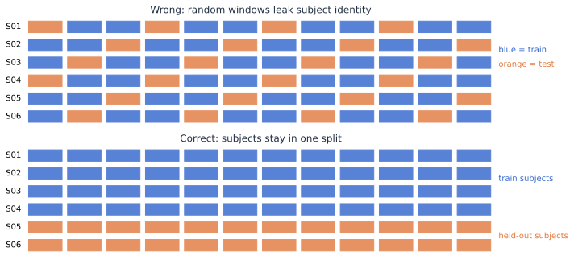

# 科研与评估规范

EEG 模型最常见的失败不是网络不够复杂，而是研究问题、数据单位和验证设计没有对齐。下面从数据层级开始建立可复现研究框架。

## 1. 先写清楚数据层级

```text
中心 / 医院
└── 受试者 / 患者
    └── 会话 / 夜晚 / 手术
        └── 连续记录
            └── Trial / 事件
                └── 窗口 / Epoch
```

下层样本共享上层的设备、个体生理和环境特征，因此通常不是独立样本。100 名患者每人 1000 个窗口仍主要是 100 个独立个体，而不是 100,000 名患者。

## 2. 看懂最危险的数据泄漏

<div class="concept-figure" markdown="1">

<small>上图把每个人的窗口混入训练与测试；下图把测试受试者完全留出。</small>
</div>

### 划分规则

| 研究目标 | 推荐测试单位 | 训练/验证内部还能做什么 |
|---|---|---|
| 同一会话实时 BCI | 连续时间块 | 训练段内选择参数 |
| 跨会话泛化 | 完整 Session | 训练 Session 内交叉验证 |
| 跨个体泛化 | 完整 Subject | 训练受试者内做 Group CV |
| 跨中心泛化 | 完整 Site | 其他中心用于训练和调参 |
| 未来时间预测 | 后续时间段 | 只用过去数据拟合 |

## 3. 所有“学习步骤”都放进训练折

下面这些操作如果使用了标签或全体数据统计量，都可能泄漏：

- 均值/方差标准化；
- 自动坏道阈值和特征筛选；
- CSP、ICA 或空间滤波器（取决于用途）；
- 频段、时间窗、通道选择；
- 过采样、欠采样和数据增强；
- 特征降维、阈值和事件后处理参数。

正确做法是使用 Pipeline：每一折只在训练部分 `fit`，再对验证/测试部分 `transform/predict`。

## 4. 指标必须对应真实问题

| 问题 | 首选指标 | 还应展示 | 不足 |
|---|---|---|---|
| 平衡 Trial 分类 | Accuracy / Balanced Accuracy | 混淆矩阵、每人分布 | 不说明概率校准 |
| 极不平衡分类 | PR-AUC、敏感度/特异度 | 阈值曲线、患病率 | AUROC 可能显得过于乐观 |
| 癫痫连续检测 | 事件敏感度、误报/小时、延迟 | 患者级时间线 | 窗口 Accuracy 无临床含义 |
| 睡眠五分类 | Macro-F1、κ、逐类召回 | Hypnogram、混淆矩阵 | 总 Accuracy 掩盖 N1 |
| 连续值预测 | MAE/RMSE、校准/一致性 | 每患者残差 | 相关高不等于一致性好 |
| BCI 在线控制 | Accuracy、ITR、无效 Trial | 校准时间、决策时长 | ITR 对假设非常敏感 |

## 5. 不只给平均数

至少报告：

- 每名受试者或患者的点和分布；
- 重采样/交叉验证不确定性；
- 类别和亚组表现；
- 失败案例与缺失数据；
- 数据量随性能变化的学习曲线；
- 与简单基线及多数类/随机基线的比较。

若样本很少，不要把大量窗口当作增加了置信度。统计推断和置信区间应以独立数据单位为基础。

## 6. 模型选择顺序

<div class="learning-flow" aria-label="EEG 模型选择顺序">
  <span>多数类/随机基线</span><b>→</b>
  <span>透明特征 + 线性模型</span><b>→</b>
  <span>经典空间滤波</span><b>→</b>
  <span>紧凑深度模型</span><b>→</b>
  <span>外部验证与消融</span>
</div>

复杂模型只有在相同划分、相同数据和相同指标上稳定优于透明基线，且增益经过不确定性评估，才有解释价值。

## 7. 最小可复现报告模板

| 模块 | 必须写清楚 |
|---|---|
| 问题 | 人群、任务、输入、输出、使用场景 |
| 数据 | 数据版本、中心、人数、记录数、时长、类别数 |
| 纳排 | 每条排除标准和排除后的数量 |
| 信号 | 设备、采样、通道、参考、单位 |
| 预处理 | 滤波、重采样、坏道、伪迹、Epoch、基线 |
| 划分 | Group、时间顺序、随机种子、嵌套验证 |
| 模型 | 特征、超参数搜索空间、停止规则 |
| 指标 | 定义、阈值、事件合并、置信区间 |
| 结果 | 主要终点、每人分布、失败和消融 |
| 复现 | 环境、代码版本、配置、数据获取说明 |
| 边界 | 混杂、偏倚、外部有效性、临床不可用范围 |

## 8. 复现不是“跑出同一个数字”

先区分：

- **计算复现**：相同代码与数据能否得到相同结果？
- **方法复现**：按论文描述独立实现是否接近？
- **结果复现**：新样本是否得到相似结论？
- **泛化验证**：不同中心、人群、设备和时间是否仍有效？

??? question "设计检查"
    假设有 20 名患者，每人 2 小时 EEG，被切成 10 秒窗口。你要预测新患者。

    - 测试集必须留出完整患者，而不是随机窗口。
    - 频段选择、标准化和特征选择只能在训练患者内完成。
    - 置信区间的独立单位主要是患者，不是所有窗口。
    - 应展示每名患者表现，并检查记录时长或设备是否成为捷径特征。
