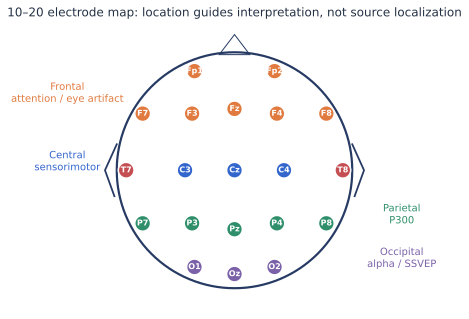
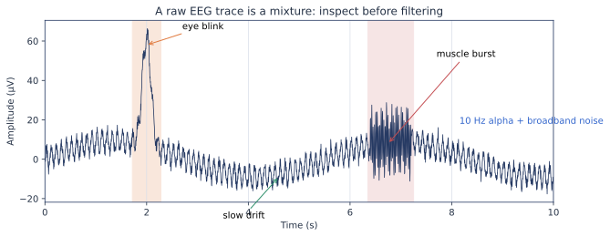
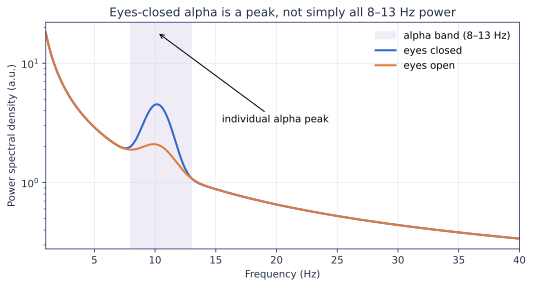
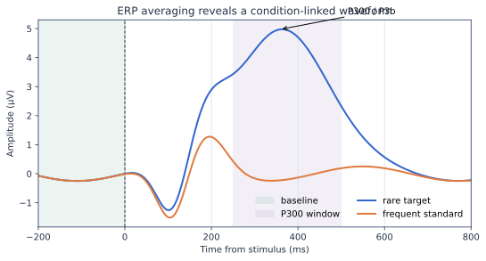
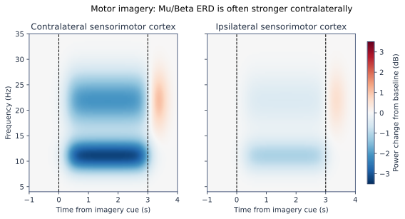
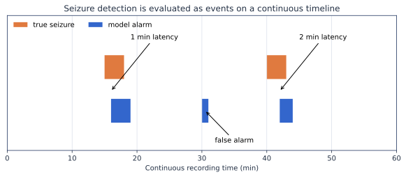
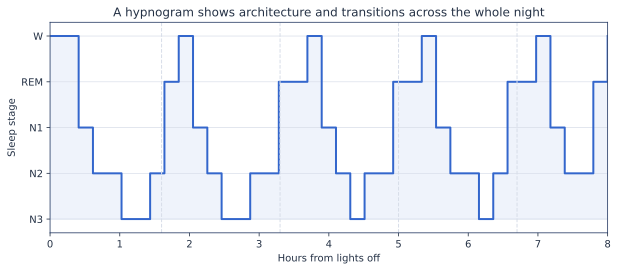
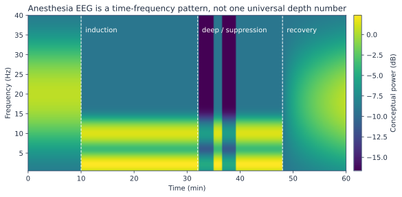

# EEG 可视化图谱

这一页不是“漂亮图片合集”，而是一张读图训练表。每张图都回答一个初学者必须掌握的问题。图中信号为教学性合成数据，不是患者记录，也不能作为生理正常范围或诊断标准。

## 1. 电极在哪里

*图解：鼻尖在上方。电极名称描述头皮位置；头皮图不能直接等同于脑源定位。*

读图顺序：先找中线 Fz/Cz/Pz/Oz，再找左右成对通道，最后把范式和区域联系起来：P300 常关注顶中央，运动想象关注 C3/C4，Alpha 与 SSVEP 常关注枕区。

## 2. 原始波形里混着什么

*图解：慢漂移、眨眼、肌电和脑节律可以同时存在；滤波前先看完整记录。*

不要只问“这是不是 Alpha”。先问幅值和时间尺度是否合理、伪迹是否只在部分通道出现、事件附近是否存在系统性运动。

## 3. PSD 怎么读

*图解：闭眼 Alpha 通常表现为枕区个体峰增强，而不是整段频谱整体抬高。*

横轴是频率，纵轴是单位频率的功率。先看 1/f 背景，再看窄带峰、工频峰和条件差异。固定 8–13 Hz 只是起点，个体峰可能偏移。

## 4. ERP 怎么读

*图解：ERP 是大量事件锁定试次的平均；时间窗与电极应尽量在看测试结果前定义。*

刺激发生在 0 ms。先检查刺激前基线，再看早期感觉成分，最后比较预先定义的 P300 时间窗。峰值更高不自动等于单试次分类更好。

## 5. 频率标记与谐波

*图解：SSVEP 不只看刺激基频，还常利用二次、三次谐波。*

## 6. 时频图怎么读

*图解：横轴是时间、纵轴是频率、颜色是相对基线的功率变化；负值表示 ERD。*

时频图必须配色条和基线定义。不能看到一块颜色就认定存在效应，还要检查单试次、伪迹和统计不确定性。

## 7. 临床事件不是窗口 Accuracy

*图解：连续检测要回答是否检出、延迟多久、无发作期间产生多少误报。*

## 8. 整夜睡眠结构

*图解：Hypnogram 让你同时检查阶段转换、周期结构和异常短跳变。*

## 9. 麻醉要看时间—频率联合变化

*图解：这只是概念示意；真实图形会随药物、年龄、刺激、设备和患者状态改变。*

## 读任何 EEG 图的五问

1. 横轴、纵轴、颜色分别是什么单位？
2. 图是单试次、单人平均、群体平均还是模型输出？
3. 参考、滤波、基线和伪迹处理是什么？
4. 图中不确定性和个体差异在哪里？
5. 这张图支持描述、统计比较、预测，还是临床决策中的哪一层结论？
